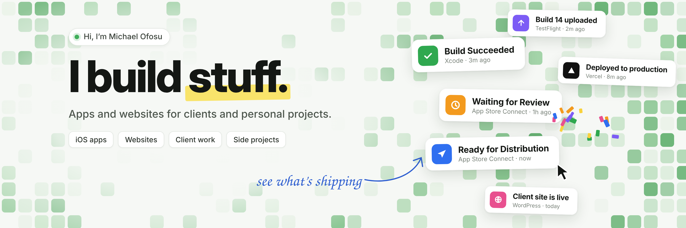

  

  <h1>Hi, I'm Michael 👋🏼</h1>

  
<b>Founder of Ace TechTrove · App Developer · Quant Trader · Fitness Coach</b>

  

    
    
    
    
  

---

I build apps people actually enjoy using. I run **[Ace TechTrove](https://acetechtrove.vercel.app)**, an independent product studio, while studying Information Systems. Outside of code, I backtest trading strategies and coach clients in the gym. Same idea everywhere: build a solid foundation, then ship real results.

## What I'm up to

- **Ace TechTrove** — Founder & CEO, designing and shipping web and mobile products end to end
- **Algorithmic trading** — building and backtesting custom indicators in Pine Script, plus quantitative analysis
- **Coaching** — helping people get stronger, one program at a time

## Tech Stack

**Languages**
 
    

**Frontend**
 
      

**Backend & Data**
 
      

**Cloud & DevOps**
 
   

**Design & Tools**
 
  

## 🤝 Let's connect

Open to collaborations, freelance work, and good conversations about products, markets, or training.
Find me at **[michaelofosu.vercel.app](https://michaelofosu.vercel.app)** or on **[LinkedIn](https://www.linkedin.com/in/ofosumichael/)** and **[X](https://x.com/michael_ofosu_)**.
